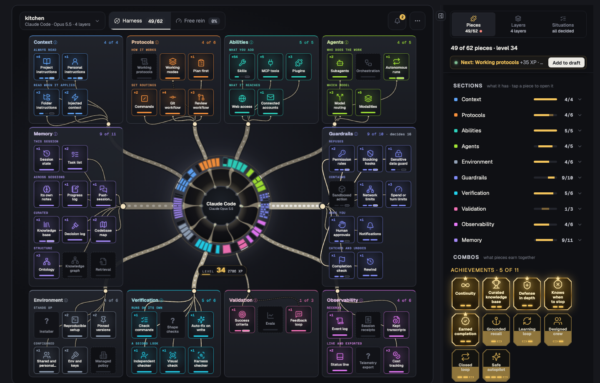

# Free Rein

**See how much free rein your agent has.**

> **Alpha.** Free Rein is under active development: some parts are
> unfinished, some don't work yet, and much will change. Treat what it shows
> as a second opinion, not a guarantee.

An AI coding agent is only as good as its **harness**: the instructions,
skills, tools, agents, hooks, permission rules, sandboxes and memory around it.
A harness grows a file at a time: an instruction here, a skill there, a hook
someone added, settings in three places, some from your home folder, some from
a plugin. Few people could say what's in theirs, or what it adds up to.

Free Rein reads a harness and draws it: every piece around the agent, where it
comes from, how the pieces work together, and where they leave gaps. It's for
understanding the harness you have, and designing the one you want.

Once you can see it, you can answer a simple question: how much free rein are
you giving your agent? And how does that change from one project to the next:
Claude Code vs Codex vs Gemini CLI, manual vs auto mode, with a given plugin or
without?



What it helps with:

- **See it whole.** 62 kinds of piece in ten sections, drawn as one picture,
  with the layers they come from: built in, yours in every repo, this repo
  shared, this repo just for you.
- **Understand how it fits.** Which pieces back each other, what they earn
  together, where they leave a weak spot, and what each runtime actually loads:
  Claude Code, Codex, Cursor, GitHub Copilot, Gemini CLI and OpenCode, read
  with one model.
- **See how much free rein it has.** For each risky action, what would happen
  and what decides it, and how that shifts when you switch the runtime, the
  mode, a layer or a plugin. Where what your instructions say and what happens
  part ways shows too.
- **Design it.** Try a change on a copy and see its effect before anything is
  written, with what would make it stronger next.

Free Rein reads files on your machine. It uses no AI model and sends nothing
anywhere. The one exception is a preview you have to turn on and start
yourself: the agent review, which hands the harness to your own agent (see
NOTICE.md).

## What's in it

- **The model** (`model/graph-schema.md`, `model/pieces.json`): 62 kinds of
  pieces in 10 sections, how they guard each other, and the levels a piece goes
  through.
- **The runtime data** (`model/runtimes/<id>.json`): how each runtime does
  each piece, every claim with a source and the date and version it was checked.
- **The harness document** (`model/schema/harness.schema.json`): the facts about
  one harness, in a stable format other tools can build on.
- **The core** (`core/`, TypeScript): reads a harness into a graph, lints it,
  evaluates its pieces, plays out its situations (trust and friction), builds the
  board's data, and writes upgrades and drafts. `free-rein` is its command line.
- **The board** (`vscode/`): a VS Code extension that draws a harness as a ring of
  pieces around the agent it wraps.

## Try it

- **In VS Code or Cursor:** download the `.vsix` from the
  [latest release](https://github.com/jordanmasters/free-rein/releases), run
  **Extensions: Install from VSIX…**, open a repo, and run **Free Rein: Open
  your harness**. See `vscode/README.md`.
- **From a clone** (Node 22 or later, macOS or Linux):

  ```bash
  npm run setup && npm run build --prefix core
  node core/out/src/cli.js check .                # what needs attention, with where and how to fix it
  node core/out/src/cli.js upgrades .             # what it could add, and how
  node core/out/src/cli.js read .                 # the harness document, as JSON
  node examples/preview.mjs samples/solo          # the board in your browser
  npm test
  ```

  `check` also runs in CI and writes SARIF for GitHub code scanning: see
  `core/README.md`.

New words (harness, piece, situation, level): see `docs/glossary.md`. Working
on Free Rein: `CONTRIBUTING.md` and `AGENTS.md`.

## Status

**Alpha, and under development.** Some parts are unfinished and some
don't work yet. The board, the command line and the harness document
(`free-rein.harness/1`) may all change before 1.0, without notice. Its claims
about each runtime are dated and sourced, and runtimes change too;
`model/runtimes/<id>.json` says when each was last checked.

Reports of a harness Free Rein reads wrongly, or of a runtime claim that's out
of date, are the most useful; see CONTRIBUTING.md.

## Licence

[MIT](LICENSE), for the code and the model data. The name, the logo and
the icon aren't covered by it: forks are welcome under another name and icon
(see [TRADEMARKS.md](TRADEMARKS.md)).

Free Rein is independent of the runtimes it reads; see NOTICE.md.
