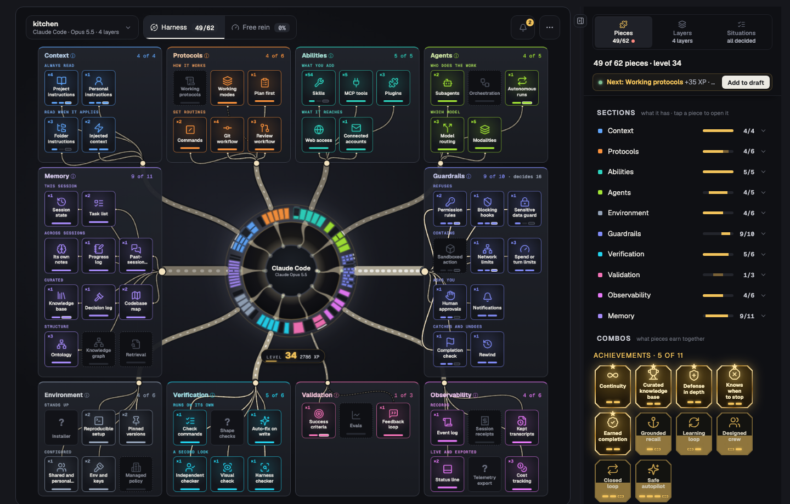
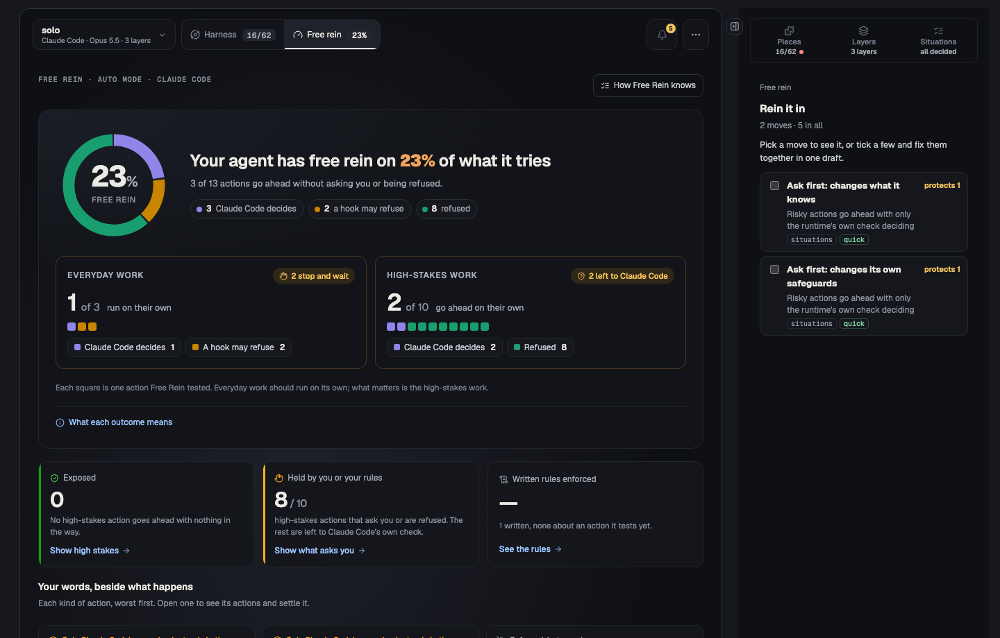

# Free Rein

**See how much free rein your agent has.**

*Your rules say one thing. What does your agent actually do?*

Your `CLAUDE.md` says "never push to main". Does anything stop your agent if it
tries? Free Rein reads your AI coding agent's **harness** (its instructions,
skills, tools, hooks, permission rules, sandbox and memory) and shows what it
has, what holds, and how much the agent does on its own.

It reads files on your machine. It uses no AI model and sends nothing anywhere.

> **Experimental.** Free Rein is under active development: some parts are
> unfinished, some don't work yet, and it changes often. It reads harnesses for
> Claude Code, Codex, Cursor, GitHub Copilot, Gemini CLI and OpenCode.

## What it shows

**The Harness view.** Every kind of piece a harness can have (62, in ten
sections such as Context, Guardrails and Memory), drawn around the agent it
wraps. A piece lights up as it goes from started to equipped to enforced:
enforced means something holds on its own, a hook that refuses or a rule that's
applied, not just a sentence that asks. Pieces that work better together earn
achievements; pieces that leave a gap together show as weak spots. Your level
rises as the harness does.

**The Free rein view.** How much your agent does on its own, and whether the
rules you wrote hold:

- the share of actions it takes without asking you or being refused, split
  into everyday work (which should run on its own) and high-stakes work
  (pushing, deleting, touching secrets, changing its own safeguards);
- each kind of action with what your words say beside what happens when it
  tries: your words and your rules agree; said, but nothing enforces it;
  enforced, but no rule says so; nothing says it and nothing stops it;
- every rule written in your instructions and skills: enforced, asking instead
  of refusing, only asked, or not something a rule could enforce.

**The side panel.**

- **Pieces:** each section and piece, where it was found (file and line), and
  what adding or strengthening it would do.
- **Layers:** where each part comes from and who gets it: built into the
  runtime, your own setup in every repo, this repo shared through git, or this
  repo just for you. Switch a layer off to see the harness without it; pick
  the runtime, its model and its mode.
- **Situations:** each risky action played through your permission rules and
  hooks, with what decides it. Choose allow, ask or never for any of them.

**How Free Rein knows** (the ⋯ menu): every check it makes, and how it knows:
read from a file's structure, matched by a pattern in your wording (so a rule
said another way can be missed), or recorded from the runtime's documentation
with a source. Each rule shows the words it was matched by.

## What it can change

Nothing, until you say so.

- **Drafts:** add a piece, a permission rule or a package, and Free Rein
  measures the change on a copy of your folder first: level, achievements, weak
  spots, what goes ahead on its own. The board marks what isn't live yet.
  **Apply…** shows every file before writing it, as one edit you can undo.
- **Upgrades:** for pieces with a template (blocking hooks, a completion check,
  permission rules, an event log and more), Free Rein writes the files. For the
  rest, it writes a precise request you can give your agent.

## Keeping up

Free Rein reads the harness again when a file it was read from changes, and
when you come back to the window. The dot on the folder's name says when it
last read your files; **⋯ → Scans** lists every scan, what started it and what
moved.

## Privacy

Free Rein reads the folder you open and, unless you turn it off
(`freeRein.countHome`), what your agent loads from your home folder. It makes
no network calls and keeps nothing outside your editor. It writes only when you
apply a change, and won't write or run anything in a folder you haven't trusted.

One preview feature is off until you turn it on: the **agent review**
(`freeRein.agentReview`). When you start it, and after it asks you, it opens
your own Claude Code in a terminal to look for what rules can't check, such as
a rule said in other words or two files that disagree. Your agent then sends
those files to its model's provider, as in your normal work; it can't read
files that look like secrets.

## Settings

| Setting | What it does |
|---|---|
| `freeRein.runtime` | The runtime the harness runs on (Claude Code by default) |
| `freeRein.countHome` | Count what loads from your home folder |
| `freeRein.showInFiles` | Mark each piece in the harness's own files, with a hover that explains it |
| `freeRein.compactBoard` | Show the board in the sidebar |
| `freeRein.palette` | The sections' colours |
| `freeRein.sounds` | Small sounds as the board changes (off by default) |
| `freeRein.agentReview` | Turn on the agent review (a preview) |

## Commands

**Free Rein: Open your harness**, **Choose a harness…**, **Upgrade a piece…**,
**Undo the last upgrade**, **Apply the draft…**, **Save the draft…**,
**Open a saved draft…**, **Read the harness again**.

## Notice

Free Rein is independent: not affiliated with, endorsed by or sponsored by
Anthropic, OpenAI, GitHub, Microsoft, Google, Anysphere (Cursor) or SST
(OpenCode). Product names are used only to identify the runtimes it reads.
